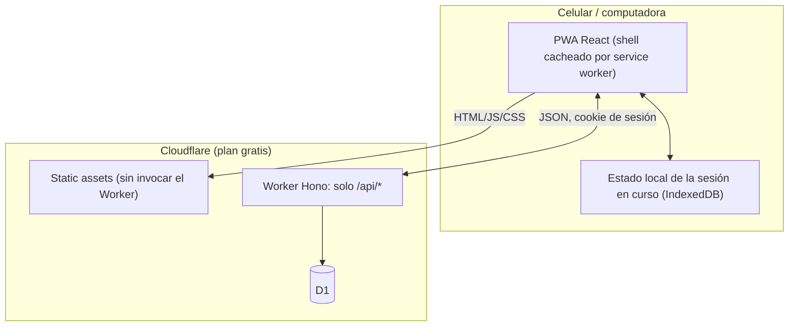
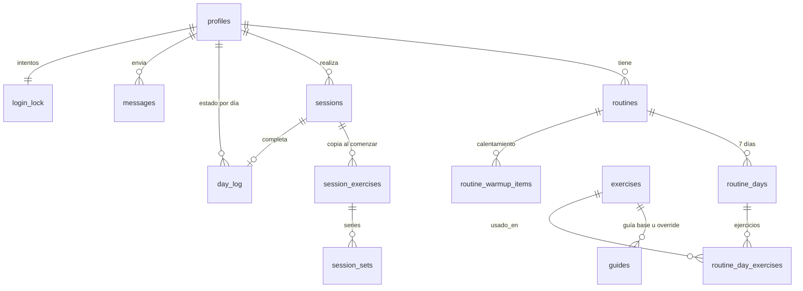
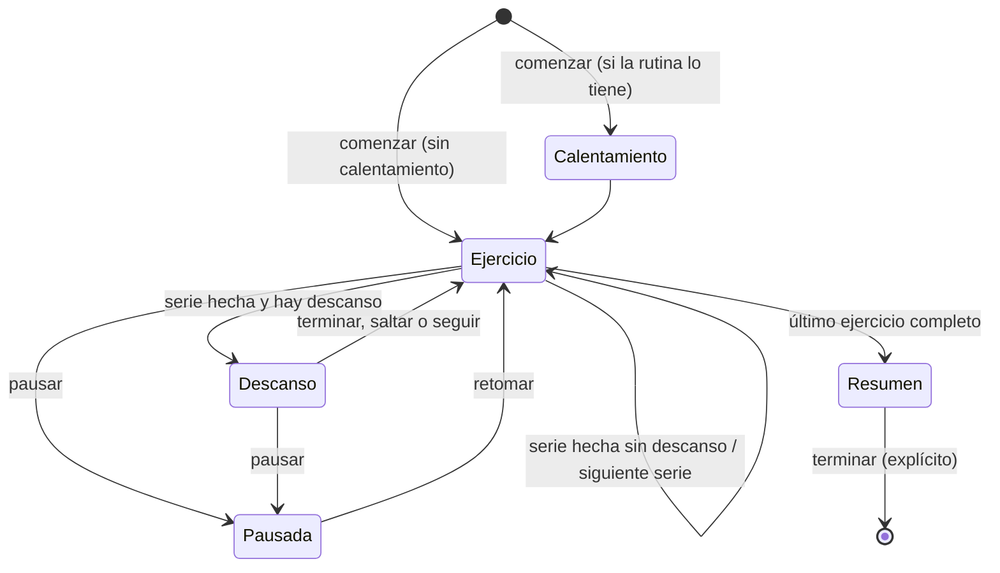

## Goal Capsule

- **Objective:** Dos personas entrenan con rutinas distintas y ajustables, siguen cada sesión paso a paso desde el celular y se acompañan con rachas compartidas y mensajes de ánimo, sin competir ni presionarse.
- **Means:** Una PWA en React servida por un único Worker de Cloudflare que también expone la API, con los datos en D1, todo dentro del plan gratis de Cloudflare (KTD1, KTD2, KTD3, KTD5).
- **Authority:** El Product Contract manda sobre el comportamiento (las dos personas son la autoridad del producto). Los KTD mandan sobre el mecanismo de implementación dentro de lo que fijan los R. Una unidad no anula ninguno de los dos.
- **Product Contract preservation:** Product Contract unchanged. Este plan solo añade Planning Contract, unidades, verificación y cierre; las preguntas diferidas del contrato se resolvieron en el plan (ver Outstanding Questions).
- **Execution profile:** Un solo pull request; el repositorio está vacío y las unidades dependen unas de otras, así que no hay una frontera que justifique dividirlo.
- **Ships and finishes:** Quien ejecute el plan construye y verifica en local y deja el repositorio listo para subir a Git. Nada se despliega desde el código: ni script de `deploy`, ni flujo de CI, ni llamadas a la cuenta de Cloudflare. El despliegue lo hace quien administra la cuenta desde el panel web de Cloudflare, conectando el repositorio, siguiendo `docs/deploy.md` (U11).
- **Stop conditions:** Detenerse y consultar si una unidad exigiría salir del plan gratis de Cloudflare (límites en KTD5) o mostrar datos privados de una persona a la otra (R3, R36).
- **Open blockers:** Ninguno. Lo que sigue abierto no bloquea la construcción (ver Outstanding Questions).

---

## Product Contract

### Summary

Gym Tracker es una página web pensada para el celular, con versión también para computadora, para dos personas. Cada una entra a su perfil con un PIN, tiene su propia rutina semanal y entrena con una guía paso a paso que explica cada ejercicio con texto. Registra series, repeticiones y pesos, y consulta su progreso en privado. Un espacio llamado "Nosotros" muestra las rachas, la semana y el estado del día de ambas, y permite enviarse mensajes de ánimo predeterminados.

### Problem Frame

Las dos personas quieren mejorar su condición física y volver el entrenamiento un hábito. Ya tienen una rutina cada una, con ejercicios, intensidad y objetivos distintos, y esa rutina cambiará con el tiempo. Sin una herramienta, tienen que recordar qué toca cada día, cuántas series, qué peso usaron la vez anterior y cuánto descansar. Tampoco saben cómo va la otra persona ni cómo acompañarla en el momento justo.

No buscan una red social ni una app de fitness grande. Buscan algo pequeño, atractivo y fácil de usar que sostenga la constancia.

### Key Decisions

- **El acceso es un PIN por perfil.** Se elige el perfil y se ingresa el PIN; el dispositivo recuerda la sesión. Protege los registros personales sin cuentas ni correos. Governs R1, R2. (session-settled: user-directed — chosen over enlace secreto, correo con enlace mágico y acceso libre: el PIN fue la opción recomendada y la elegida.)
- **Las guías de los ejercicios son solo texto.** Sin imágenes, GIF, videos ni animaciones. Cada ejercicio explica por escrito, paso a paso, cómo hacerlo. Governs R15, R16, R17. (session-settled: user-directed — chosen over animaciones simples hechas para la app y enlaces a videos: se prefiere texto bien explicado.)
- **La paleta es negro con azul eléctrico, cian y un acento ámbar.** Reemplaza al morado y rosado del planteamiento inicial. Se mantiene la regla de no usar verde ni rojo. Los tonos exactos se definen en el diseño. Governs R40. (session-settled: user-directed — chosen over negro, morado y rosado: la persona pidió otros colores sobre fondo negro; la combinación concreta la propuse yo.)
- **Este documento solo define el producto.** La arquitectura, las tecnologías, el reparto del trabajo y las pruebas quedan fuera y se tratan después. (session-settled: user-directed — chosen over incluir una propuesta técnica en este documento.)
- **Una rutina es un punto de partida, no algo fijo.** Cada persona la edita sin afectar a la otra ni a lo ya registrado. Governs R8, R9.
- **Una sesión es una copia de lo que se entrenó ese día.** Al comenzar una sesión se guarda lo que la rutina decía en ese momento, de modo que editar o borrar la rutina después no cambia el historial. Governs R9, R30.
- **Lo compartido es poco y está definido.** Racha, sesiones de la semana, calendario de estados del día y mensajes. Todo lo demás es privado. Governs R35, R36.
- **Los días de recuperación activa (miércoles) son sesiones programadas.** Tienen su guía y cuentan para la racha al terminarlas. Los sábados y domingos son descanso programado. Governs R33.

### Requirements

**Perfiles y acceso**

- R1. Existen dos perfiles independientes, cada uno con nombre, rutina semanal, historial y estadísticas propios.
- R2. Cada perfil se abre con un PIN; la sesión se recuerda en ese dispositivo hasta que la persona cierre sesión.
- R3. Los datos privados de una persona (rutinas, pesos, repeticiones, historial, estadísticas) no se muestran a la otra.
- R4. Cada persona ve sus propios datos y los datos compartidos actualizados desde su celular, aunque la otra los haya generado desde otro dispositivo.

**Rutinas**

- R5. Cada perfil arranca con su rutina inicial (ver Rutinas iniciales). Ambas son modificables desde el primer día.
- R6. Una rutina semanal asigna a cada día de la semana una sesión de entrenamiento o un descanso programado.
- R7. Cada persona puede crear una rutina desde cero, duplicar una existente como base, editar su nombre y descripción, activarla, desactivarla, reemplazarla o eliminarla. Solo una rutina está activa a la vez por persona.
- R8. Dentro de una rutina se puede agregar, quitar y reordenar ejercicios, asignarlos a distintos días y convertir un día en descanso o al revés.
- R9. Los cambios en una rutina se aplican a las sesiones futuras; las sesiones ya terminadas no se modifican.
- R10. Cada ejercicio de una rutina tiene series, repeticiones o tiempo objetivo (admite rangos como 12–15), peso y descanso entre series, todos editables.
- R11. Los ejercicios principales y los accesorios tienen descansos distintos y configurables. Los valores iniciales de cada persona están en Rutinas iniciales.
- R12. Las rutinas pueden tener un calentamiento propio, activable o no, que se muestra antes de la sesión.
- R13. Los ejercicios pueden medirse en repeticiones, repeticiones por lado, segundos, segundos por lado o minutos. Algunos pueden no tener series (por ejemplo, estiramientos suaves).
- R14. La rutina de la persona 1 muestra una indicación de volumen reducido para sus dos primeras semanas (hasta 3 series en principales y 2 en accesorios). Es una guía visible que ella decide seguir o no; la app no limita las series.

**Ejercicios y guía en texto**

- R15. Cada ejercicio tiene una guía escrita con: nombre, músculos principales, materiales necesarios, series y repeticiones recomendadas, pasos numerados para hacerlo, consejos de técnica y errores comunes.
- R16. Los pasos están escritos para alguien que no conoce el ejercicio: posición inicial, movimiento, posición final, respiración cuando aplique y cómo volver.
- R17. Todos los ejercicios de las dos rutinas iniciales llegan con su guía completa. Los ejercicios que una persona agregue después pueden tener la guía en blanco y se pueden completar por escrito.
- R18. Un mismo ejercicio puede estar en las dos rutinas con prescripciones distintas (series, repeticiones, peso, descanso) y comparte la misma guía.
- R19. Se pueden crear ejercicios propios con su guía y editar las guías existentes.

**Pantalla de inicio**

- R20. Inicio muestra la sesión que toca hoy (o el descanso programado), el resumen de la semana y el botón "Comenzar entrenamiento".
- R21. Si hay una sesión pausada, Inicio ofrece retomarla.

**Entrenamiento guiado**

- R22. "Comenzar entrenamiento" abre una pantalla que guía toda la sesión en este orden: calentamiento (si la rutina lo tiene), primer ejercicio, sus series, descanso, siguiente serie o ejercicio, y resumen final.
- R23. Para cada ejercicio la pantalla muestra solo lo necesario para hacerlo: nombre, serie actual, repeticiones o tiempo objetivo, peso, materiales y la guía en texto, que se despliega a pedido.
- R24. Cada serie se registra por separado con las repeticiones (o segundos) y el peso realmente usados. Los valores sugeridos parten de lo planeado o de la última vez.
- R25. Al marcar una serie como hecha, el temporizador de descanso arranca solo cuando el ejercicio tiene descanso configurado.
- R26. El temporizador permite pausar, continuar, sumar 15 segundos, saltar el descanso y pasar al siguiente ejercicio cuando corresponda. Terminar el tiempo no marca ninguna serie como hecha.
- R27. Completar una serie y completar un ejercicio son acciones distintas; el ejercicio se da por completo cuando la persona lo indica o cuando termina todas sus series.
- R28. Si la rutina tiene calentamiento, tras él se ofrece una serie ligera del primer ejercicio de fuerza.
- R29. Una sesión se puede pausar y retomar después sin perder lo registrado, incluso si se cierra la página.
- R30. Al terminar se muestra un resumen: ejercicios completados, series realizadas, repeticiones registradas y duración aproximada. La sesión queda guardada como una copia de lo que se hizo (según R9).
- R31. Una sesión cuenta como completada solo cuando la persona la termina de forma explícita. Abrir la app o comenzar una sesión no cuenta.

**Progreso individual**

- R32. "Mi progreso" muestra: entrenamientos completados, historial cronológico, sesiones por semana, porcentaje de cumplimiento de la rutina, evolución de pesos, evolución de repeticiones y el detalle de cada sesión realizada. Es privado.

**Espacio compartido: Nosotros**

- R33. Cada persona tiene su propia racha, calculada según sus días programados. Los descansos programados no la rompen. Un día programado que pasa sin sesión completada la rompe. La racha de una persona no depende de la otra.
- R34. "Nosotros" muestra, para cada persona: nombre, racha actual, sesiones completadas esta semana y el estado de hoy.
- R35. Hay un calendario de actividad compartido donde cada día de cada persona aparece como completado, pendiente o descanso programado. Los pendientes se distinguen visualmente de los descansos.
- R36. Lo único que se comparte es lo de R34 y R35 más los mensajes de R37. Las rutinas, ejercicios, pesos y repeticiones de una persona no se muestran a la otra.
- R37. Cada persona puede enviar a la otra un mensaje elegido de una lista de frases de ánimo predeterminadas (por ejemplo "¡Tú puedes! 💪", "¡Estoy contigo! 💜", "¡Un entrenamiento más!"). Los mensajes se ven dentro de "Nosotros".
- R38. Se puede enviar un mensaje tanto cuando la otra persona ya entrenó como cuando todavía tiene el entrenamiento pendiente.
- R39. No hay chat libre, notificaciones push ni recordatorios automáticos. La otra persona ve los mensajes al abrir la app.

**Diseño y navegación**

- R40. La interfaz es oscura, con fondo negro o gris muy oscuro, tarjetas oscuras, azul eléctrico y cian como colores principales y un acento ámbar. No usa verde ni rojo. Tiene bordes redondeados, tipografía clara, animaciones discretas e iconos simples, y se siente como una app de fitness, no como un panel administrativo.
- R41. Está optimizada para el celular durante el entrenamiento, con botones grandes y texto legible, y también funciona bien en computadora.
- R42. Se accede por una URL y se puede agregar a la pantalla de inicio del celular.
- R43. La navegación tiene cinco secciones: Inicio, Entrenar, Nosotros, Mi progreso y Mis rutinas. Mis rutinas puede vivir dentro del perfil o la configuración si eso simplifica la navegación.

### Key Flows

- F1. Entrenar un día normal
  - **Trigger:** La persona abre la app y toca "Comenzar entrenamiento" en Inicio.
  - **Steps:** Ve el calentamiento, hace la serie ligera, pasa al primer ejercicio, lee la guía si la necesita, registra cada serie, descansa con el temporizador, continúa hasta el último ejercicio y toca "Terminar".
  - **Outcome:** La sesión queda guardada, se actualiza su racha y su día pasa a completado en "Nosotros".
  - **Covered by:** R22–R31, R33–R35

- F2. Pausar y retomar
  - **Trigger:** La persona tiene que interrumpir la sesión a la mitad.
  - **Steps:** Pausa la sesión; más tarde abre Inicio, ve la sesión pausada y la retoma en el punto donde quedó.
  - **Outcome:** Los registros anteriores siguen ahí.
  - **Covered by:** R21, R29

- F3. Animar a la otra persona
  - **Trigger:** En "Nosotros", una persona ve que la otra aún no entrenó hoy, o que ya terminó.
  - **Steps:** Elige una frase de ánimo y la envía.
  - **Outcome:** La otra persona la ve al abrir "Nosotros".
  - **Covered by:** R34, R37–R39

- F4. Ajustar la rutina
  - **Trigger:** Una persona quiere cambiar su rutina (más peso, otro ejercicio, otro día).
  - **Steps:** En Mis rutinas, edita o duplica la rutina, cambia lo que necesita y la activa.
  - **Outcome:** Las próximas sesiones usan el cambio; el historial no se altera y la rutina de la otra persona queda intacta.
  - **Covered by:** R7–R10, R5

### Acceptance Examples

- AE1. **Covers R9, R30.** Dado que la persona 1 terminó el lunes una sesión con "Sentadilla búlgara", cuando el martes elimina ese ejercicio de su rutina, entonces el lunes sigue mostrando la sentadilla búlgara con sus series y pesos en "Mi progreso".
- AE2. **Covers R26, R27.** Dado que el descanso de una serie llega a 0, entonces la serie siguiente no se marca ni se inicia sola, y la persona decide cuándo registrarla.
- AE3. **Covers R33.** Dado que la persona 2 entrena de lunes a miércoles y falta el jueves, cuando termina el jueves, entonces su racha vuelve a empezar; la racha de la persona 1 no cambia.
- AE4. **Covers R33, R35.** Dado que sábado y domingo son descanso programado, cuando una persona entrena viernes y lunes, entonces su racha continúa y el sábado y el domingo aparecen como descanso, no como pendiente.
- AE5. **Covers R3, R36.** Dado que la persona 1 registró 40 kg en hip thrust, cuando la persona 2 abre "Nosotros", entonces ve solo el estado del día, la racha y las sesiones de la semana de la persona 1, no el peso.
- AE6. **Covers R29.** Dado que la persona cierra el navegador en el ejercicio 3 de 5 con dos series registradas, cuando vuelve a abrir la app, entonces puede retomar en ese ejercicio con esas dos series intactas.
- AE7. **Covers R4.** Dado que la persona 1 termina su sesión en su celular, cuando la persona 2 abre "Nosotros" en el suyo, entonces ve el día de la persona 1 como completado.

### Success Criteria

- Las dos personas pueden entrenar un día completo solo con la app: ver qué toca, seguir la guía, registrar las series y terminar, sin consultar nada más.
- Cualquiera puede editar su rutina y sus pesos sin perder ni alterar lo ya registrado.
- Ambas ven el estado y la racha de la otra desde su propio celular, y sus registros personales siguen siendo privados.
- La app sigue siendo pequeña: cinco secciones y nada de lo listado en Scope Boundaries.

### Scope Boundaries

**Fuera de la primera versión**

- Imágenes, GIF, videos o animaciones de los ejercicios. Las guías son texto.
- Red social, seguidores, rankings o competencias.
- Chat completo o mensajes escritos libremente. Podría evaluarse después.
- Notificaciones push y recordatorios automáticos.
- Planes de pago.
- Seguimiento nutricional, calorías y porcentaje de grasa corporal.
- Inteligencia artificial.
- Cualquier función que complique la app sin ayudar a entrenar con constancia.

**Fuera de este documento**

- La organización del desarrollo entre las dos personas. La arquitectura, las tecnologías, la estructura de datos, el despliegue y las pruebas están en el Planning Contract y en las unidades.

---

## Planning Contract

### Stack

| Capa | Elección | Notas |
|---|---|---|
| Plataforma | Cloudflare (plan gratis) | Un solo Worker con assets estáticos, base D1. Sin otros proveedores. |
| Frontend | React + Vite + TypeScript | PWA con `vite-plugin-pwa`; `@cloudflare/vite-plugin` para desarrollo y build contra el mismo runtime del Worker. |
| Datos en cliente | TanStack Query + almacenamiento local (IndexedDB) | Caché de lecturas y estado de la sesión en curso. |
| Estilos | Tailwind CSS sobre variables CSS de diseño; iconos `lucide-react` | Gráficas propias en SVG para no sumar una librería pesada. |
| API | Hono + Zod en el Worker | Validación compartida con el cliente desde `shared/`. |
| Base de datos | D1 con migraciones en archivos SQL y SQL directo (sin ORM) | Consultas acotadas por índice para controlar filas leídas. En local se aplican con `wrangler`; en producción se pegan en la consola de D1 del panel. |
| Pruebas | Vitest (+ `@cloudflare/vitest-pool-workers` para el Worker y D1) y Playwright | Ver Verification Contract. |

### High-Level Technical Design

Tres vistas: componentes, datos y la sesión de entrenamiento.







### Output Structure

```text
wrangler.jsonc  package.json  vite.config.ts  vitest.config.ts  playwright.config.ts  index.html
migrations/0001_init.sql
seed/            exercises.ts  routines.ts  guides/
scripts/         seed.ts  set-pin.ts
shared/          schemas.ts  phrases.ts  streak.ts  dates.ts
worker/          index.ts  auth/  routes/  lib/
src/             main.tsx  app/  features/{home,train,routines,progress,us}/  ui/  lib/  styles/tokens.css
test/            (pruebas del Worker y de lógica pura)
e2e/             (Playwright)
```

El árbol es una declaración de forma, no una restricción; el `Files:` de cada unidad manda.

### Key Technical Decisions

- KTD1. **Cloudflare como única plataforma.** Web, API y datos viven en una sola cuenta, sin backend de terceros. (session-settled: user-directed — chosen over Supabase + Vercel, Firebase y servidor propio: se prefiere todo en Cloudflare.)
- KTD2. **Un Worker con assets estáticos, no Pages.** Cloudflare recomienda Workers con assets para proyectos nuevos y concentra ahí las novedades. Los assets se sirven sin invocar el Worker; solo `/api/*` lo ejecuta (`run_worker_first` limitado a esa ruta). Web y API salen en un solo despliegue. (session-settled: user-approved — chosen over Cloudflare Pages + Functions: un solo despliegue y requests de assets sin costo.)
- KTD3. **D1 como almacenamiento.** El historial, las rachas y las copias de sesión son datos relacionales con consultas por rango de fechas. (session-settled: user-approved — chosen over KV y R2: no sirven para consultas relacionales.)
- KTD4. **React + Vite + TypeScript en el cliente; Hono + Zod en el Worker.** Los esquemas de `shared/` validan la misma forma en ambos lados. (session-settled: user-directed — chosen over Svelte y JavaScript simple: ecosistema más grande y soporte PWA.) Hono y Zod no tienen etiqueta: son elección de planificación.
- KTD5. **El plan gratis de Cloudflare es una restricción de diseño.** Cada decisión de abajo se mide contra estos límites; superarlos es una condición de parada (ver Goal Capsule). (session-settled: user-directed — chosen over aceptar un plan de pago: se pidió no rebasar el plan gratis.) Los límites y el uso esperado:

  | Recurso (plan gratis) | Límite | Uso esperado, 2 personas | Palancas de diseño |
  |---|---|---|---|
  | Requests al Worker | 100 000 por día | Unos 150 por día | Assets sin Worker (KTD2); caché en cliente; sin sondeo periódico (KTD10) |
  | CPU por request | 10 ms | Pocos ms por llamada | JSON pequeño, sin hash en cada request (KTD6) |
  | D1 filas leídas | 5 000 000 por día (la cuota se aplica con fallo de consultas desde el 1 de septiembre de 2026) | Unos miles por día | Todo por índice, rangos acotados, un solo `bootstrap` |
  | D1 filas escritas | 100 000 por día (los índices cuentan) | Unos cientos por día | Escritura por serie, no por tecla; sin tablas de eventos |
  | D1 tamaño | 500 MB por base | Menos de 10 MB en años | Sin binarios ni imágenes en D1 |

  Las cifras de uso son estimaciones de planificación; U11 las verifica con las cuentas reales de filas que devuelve D1.
- KTD6. **Acceso por PIN de 6 dígitos con cookie firmada sin estado.** El PIN se guarda con sal y PBKDF2 (iteraciones ajustadas para caber en el CPU gratis); un login correcto emite una cookie `HttpOnly`, `Secure` y `SameSite=Strict` firmada con HMAC y vencimiento largo (la API solo acepta cuerpos JSON, lo que cierra el CSRF), de modo que ninguna request posterior lee D1 para autenticar. La fila `login_lock` bloquea el perfil tras 5 fallos seguidos con espera creciente, y mientras el bloqueo dure el Worker responde sin escribir en D1 (así un ataque no agota las escrituras). Si alguien olvida su PIN, quien administra ejecuta `scripts/set-pin.ts` y pega el SQL resultante en la consola de D1 del panel; no hay recuperación automática (no hay correo). (session-settled: user-approved — chosen over PIN corto sin bloqueo y recuperación por correo: protege con poco mecanismo y sin servicios extra.) Gobierna R2.
- KTD7. **La sesión en curso vive primero en el celular y se sincroniza por serie.** El cliente genera el identificador de la sesión, guarda cada serie en IndexedDB y la envía al servidor en una escritura pequeña e idempotente (reintentable); "Terminar" confirma la sesión. Sin señal, lo registrado no se pierde y se reenvía al volver. (session-settled: user-approved — chosen over guardar solo en el servidor: una señal mala en el gimnasio no debe perder una serie.) Gobierna R24, R29.
- KTD8. **Una sesión es una copia relacional de lo planeado.** Al comenzar se insertan `session_exercises` con nombre, prescripción y descanso copiados de la rutina; las series cuelgan de ahí. Editar o borrar la rutina o el ejercicio no toca el historial. Gobierna R9, R30; cubre AE1.
- KTD9. **El estado de cada día se materializa en `day_log`.** Estados `completed`, `pending` o `rest` por perfil y fecha. Los días pasados sin materializar se cierran de forma idempotente al leer (y siempre antes de activar o editar una rutina, para que el cambio no reescriba el pasado). Las fechas usan la zona `America/La_Paz` fija. La racha es una función pura sobre `day_log`: los `completed` suman, los `rest` se saltan, el primer `pending` pasado la corta; el día de hoy aún abierto no la rompe. No se registran ni corrigen sesiones de días pasados en la primera versión. (session-settled: user-approved — chosen over permitir corregir días pasados y tarea programada diaria: racha simple y sin trabajo de fondo.) Gobierna R33, R35; cubre AE3, AE4.
- KTD10. **"Nosotros" se lee al abrir; no hay sondeo ni tiempo real.** Una consulta propia devuelve solo la lista blanca de R34, R35 y los mensajes de R37; no reutiliza las consultas privadas. El cliente la pide al abrir la sección y al volver a primer plano (con un mínimo de 30 s entre pedidos). Gobierna R36, R39; cubre AE5, AE7.
- KTD11. **Las guías tienen base y copia propia.** La guía base de cada ejercicio es compartida; si una persona edita una guía, se guarda una copia solo suya (`guides` con `profile_id`) y su lectura usa la copia si existe. Los ejercicios propios pertenecen a quien los crea. Los ejercicios y guías iniciales viven en `seed/` y se cargan con `scripts/seed.ts`. Gobierna R15–R19, R3.
- KTD12. **Medidas "por lado", segundos y minutos se registran con un solo campo.** Cada serie tiene un valor (repeticiones, segundos o minutos) y el peso; "por lado" se muestra como etiqueta y se asume igual en ambos lados. Un ejercicio sin series (estiramientos) se marca solo como hecho. Gobierna R13, R24.
- KTD13. **El estado visual se codifica con forma y color, nunca con verde ni rojo.** Completado: marca rellena en cian. Pendiente: aro ámbar. Descanso programado: guion gris. Los tonos de azul eléctrico, cian y ámbar son variables en `src/styles/tokens.css` y U7 los fija verificando contraste de texto de al menos 4,5:1 sobre el fondo oscuro. Gobierna R35, R40.
- KTD14. **Dos niveles de prueba.** Pruebas del Worker contra una D1 real de prueba y de la lógica pura (racha, fechas, instantánea) con Vitest; una prueba Playwright en viewport de celular recorre una sesión completa. Se descartó probar contra mocks de D1, porque ocultan consultas que leen de más.

### Assumptions

- La zona horaria de ambas personas es `America/La_Paz` y no cambia (KTD9). Si una viaja, los días se calculan igual; se acepta.
- Cada persona usa un celular propio; no hay inicio de sesión simultáneo en muchos dispositivos que justifique revocar sesiones. Revocar significa rotar el secreto de firma, lo que cierra las dos sesiones.
- Una sesión extra en un día de descanso programado se guarda en el historial pero no cambia la racha. El documento de requisitos no la define; se deja así hasta que lo pidan.

### Scope Boundaries (de planificación)

**Considerado y no construido**

- Cron Trigger para cerrar días: la materialización perezosa de KTD9 lo evita y un job fallido dejaría huecos que la lectura corrige igual. Cambiaría la decisión si el estado de "Nosotros" necesitara estar al día sin que nadie abra la app.
- Limitador de peticiones por IP o binding de rate limiting: el bloqueo por perfil de KTD6 ya acota las escrituras y no hay datos de valor para un atacante anónimo. Cambiaría la decisión si aparecieran intentos de abuso con costo real.
- Service worker con caché de respuestas de la API: duplicaría la caché de TanStack Query y complicaría invalidar datos privados. El service worker solo precachea el shell.
- Tests de carga: el uso esperado está dos órdenes de magnitud bajo los límites; U11 verifica filas y requests reales en lugar de simular carga.

### Risks & Dependencies

| Riesgo | Mitigación |
|---|---|
| El hash PBKDF2 del PIN supera los 10 ms de CPU del plan gratis y el login falla | Ajustar iteraciones en U3 midiendo el login desplegado en U11; el bloqueo de KTD6 es la defensa principal, el costo del hash solo importa si se filtra la base. |
| Una consulta nueva lee muchas filas por falta de índice y se acerca al límite diario de D1 | Cada endpoint registra `rows_read` en pruebas (U11); las consultas de historial llevan rango de fechas y `LIMIT`. |
| Alguien puede bloquear a una persona fallando su PIN a propósito | Aceptado: con 2 personas y PIN privado el riesgo es bajo; el bloqueo es temporal y `set-pin` lo reinicia. |
| El límite gratis cambia o se aplica distinto a lo documentado hoy | KTD5 enumera los límites vigentes (verificados en la documentación de D1 en noviembre de 2026); revisar en U11 antes de desplegar. |
| La redacción de las guías depende de las dos personas | U4 genera borradores completos con la forma del apéndice; revisarlos no bloquea la construcción. |

Referencias externas que sostienen estas decisiones: [Workers Static Assets frente a Pages](https://developers.cloudflare.com/workers/static-assets/migrate-from-pages/) y [límites y aplicación del plan gratis de D1](https://developers.cloudflare.com/changelog/post/2026-09-01-d1-free-tier-limit-enforcement/).

---

## Implementation Units

| U-ID | Título | Archivos clave | Depende de |
|---|---|---|---|
| U1 | Andamiaje y configuración de Cloudflare | `wrangler.jsonc`, `vite.config.ts`, `worker/index.ts` | — |
| U2 | Esquema de datos y herramientas de carga | `migrations/0001_init.sql`, `scripts/seed.ts` | U1 |
| U3 | Acceso por PIN | `worker/auth/`, `scripts/set-pin.ts` | U2 |
| U4 | Ejercicios, guías y rutinas (API y datos iniciales) | `worker/routes/routines.ts`, `seed/` | U3 |
| U5 | Sesiones, estado del día y racha | `worker/routes/sessions.ts`, `shared/streak.ts` | U4 |
| U6 | Progreso y "Nosotros" (API) | `worker/routes/progress.ts`, `worker/routes/us.ts` | U5 |
| U7 | Base del frontend, tema y PWA | `src/app/`, `src/styles/tokens.css` | U1 |
| U8 | Inicio y Mis rutinas | `src/features/home/`, `src/features/routines/` | U4, U5, U7 |
| U9 | Entrenamiento guiado | `src/features/train/` | U5, U7, U8 |
| U10 | Mi progreso y Nosotros (pantallas) | `src/features/progress/`, `src/features/us/` | U6, U7 |
| U11 | Despliegue, controles del plan gratis y prueba de punta a punta | `e2e/`, `test/budget.test.ts` | U1–U10 |

### U1. Andamiaje y configuración de Cloudflare

**Goal:** Un proyecto que construye, corre en local y despliega como un solo Worker con assets, con la API bajo `/api/*`.
**Requirements:** R42; KTD1, KTD2, KTD4, KTD5.
**Dependencies:** ninguna.
**Files:** `wrangler.jsonc`, `package.json`, `tsconfig.json`, `vite.config.ts`, `vitest.config.ts`, `index.html`, `worker/index.ts`, `src/main.tsx`, `test/health.test.ts`.
**Approach:**
- Configurar `wrangler.jsonc` con el binding de D1, el directorio de assets del build y `run_worker_first` solo para `/api/*`.
- Respuesta de fallback a `index.html` para rutas del cliente, de modo que el router del frontend funcione al recargar.
- Un endpoint `/api/health` mínimo y los scripts de `package.json` que usa el Verification Contract.
**Patterns to follow:** documentación de Workers Static Assets y del plugin de Vite para Cloudflare; no hay código local.
**Test scenarios:**
- `/api/health` responde 200 con JSON desde el Worker en pruebas.
- Una ruta desconocida bajo `/api/` devuelve 404 JSON, no el HTML del cliente.
**Verification:** el build produce los assets y el Worker; `wrangler deploy --dry-run` no reporta errores; el modo de desarrollo sirve la página y `/api/health`.

### U2. Esquema de datos y herramientas de carga

**Goal:** La base con todas las tablas e índices del diagrama y un comando para cargarla con los datos iniciales.
**Requirements:** R1, R5, R9; KTD3, KTD5, KTD8, KTD9, KTD11.
**Dependencies:** U1.
**Files:** `migrations/0001_init.sql`, `scripts/seed.ts`, `shared/schemas.ts`, `test/schema.test.ts`.
**Approach:**
- Tablas: `profiles`, `login_lock`, `exercises`, `guides`, `routines`, `routine_days`, `routine_warmup_items`, `routine_day_exercises`, `sessions`, `session_exercises`, `session_sets`, `day_log`, `messages`.
- Un índice único parcial por perfil con `is_active = 1` impone una sola rutina activa (R7).
- Índices pensados para KTD5: `sessions(profile_id, local_date)`, `session_exercises(session_id)`, `session_exercises(exercise_id)`, `session_sets(session_exercise_id)`, `day_log` con clave `(profile_id, date)`, `messages(to_profile_id, created_at)`.
- Identificadores de sesión en texto (UUID del cliente) para la idempotencia de KTD7; el resto con enteros.
- `scripts/seed.ts` toma de variables los nombres de los dos perfiles (por defecto "Persona 1" y "Persona 2") y genera un archivo SQL con lo que U4 define, repetible sin duplicar; en local lo aplica a la D1 de desarrollo y para producción se pega en la consola de D1.
**Test scenarios:**
- Aplicar las migraciones sobre una D1 vacía de pruebas crea todas las tablas.
- Insertar una segunda rutina activa para el mismo perfil falla; para otro perfil funciona.
- Ejecutar el seed dos veces deja el mismo número de ejercicios y rutinas.
**Verification:** las migraciones se aplican de cero en local y el seed es repetible.

### U3. Acceso por PIN

**Goal:** Entrar a un perfil con su PIN, recordar el dispositivo y proteger todo `/api/*` salvo el login.
**Requirements:** R2, R3, R4; KTD6.
**Dependencies:** U2.
**Files:** `worker/auth/pin.ts`, `worker/auth/session.ts`, `worker/auth/lock.ts`, `worker/routes/auth.ts`, `scripts/set-pin.ts`, `test/auth.test.ts`.
**Approach:**
- Rutas de login, cierre de sesión y "quién soy"; el middleware extrae el `profile_id` de la cookie firmada y lo pone en el contexto. Ninguna consulta posterior acepta un `profile_id` del cuerpo o de la URL.
- El flujo de bloqueo de KTD6: comprobar `locked_until` antes de verificar el PIN; si está bloqueado, responder sin escribir.
- `set-pin.ts` calcula el hash y emite la sentencia SQL para pegar en la consola de D1 del panel, de modo que el PIN nunca se guarda en el repositorio.
**Test scenarios:**
- Login con el PIN correcto devuelve cookie `HttpOnly` y `/api/me` responde con el perfil.
- Una petición a cualquier ruta protegida sin cookie devuelve 401.
- Una cookie alterada o vencida devuelve 401.
- Cinco PIN incorrectos seguidos bloquean el perfil; el sexto intento, aun con el PIN correcto, devuelve bloqueo.
- Durante el bloqueo no se escribe ninguna fila (se verifica contando escrituras).
- El bloqueo de un perfil no afecta el login del otro.
- Cierre de sesión invalida el uso de la cookie en el cliente (se borra) y el login posterior funciona.
- Una petición con cuerpo que no es JSON a una ruta que escribe se rechaza.
**Verification:** un recorrido login → `/api/me` → logout funciona en local; el PIN no aparece en logs ni en el repositorio.

### U4. Ejercicios, guías y rutinas (API y datos iniciales)

**Goal:** Crear, duplicar, editar, activar y eliminar rutinas por perfil, con ejercicios y guías, y arrancar con las dos rutinas del apéndice.
**Requirements:** R5–R8, R10–R19, R14; KTD11, KTD12.
**Dependencies:** U3.
**Files:** `worker/routes/routines.ts`, `worker/routes/exercises.ts`, `shared/schemas.ts`, `seed/exercises.ts`, `seed/routines.ts`, `seed/guides/`, `test/routines.test.ts`, `test/exercises.test.ts`.
**Approach:**
- Rutas de rutinas con las operaciones de R7 y edición de días y ejercicios de R8 y R10; toda consulta filtra por el `profile_id` del contexto (R3). Una rutina activada desactiva la anterior en la misma transacción (`batch`).
- Antes de activar o editar una rutina se cierran los días pendientes del perfil (llamada a la función de U5 sobre `day_log`, KTD9).
- Descansos por rol (principal o accesorio) como valores por defecto del ejercicio y editables (R11); calentamiento como lista aparte con interruptor por día (R12).
- La indicación de volumen reducido de R14 es un campo de la rutina inicial de la persona 1 con fecha de fin de dos semanas, solo informativo.
- Guías: lectura con la regla base-o-copia de KTD11; editar crea la copia del perfil; ejercicios propios con guía opcional (R17, R19).
- Datos iniciales: todos los ejercicios de las dos rutinas del apéndice con borrador de guía completo (R15, R16), con la forma de "Forma de la guía de un ejercicio". Los borradores los revisan las dos personas.
**Test scenarios:**
- La rutina inicial de la persona 1 tiene lunes, martes, jueves y viernes como sesiones, miércoles como recuperación activa con su guía y sábado y domingo como descanso.
- Duplicar una rutina crea una copia independiente: editarla no cambia la original.
- Activar una rutina desactiva la anterior; nunca quedan dos activas.
- Un perfil no puede leer, editar ni activar una rutina del otro (404 o 403).
- Un ejercicio presente en las dos rutinas muestra prescripciones distintas y la misma guía base (R18).
- Editar la guía de un ejercicio base como persona 1 no cambia la guía que ve la persona 2.
- Un ejercicio propio sin guía se guarda y luego se completa por escrito.
- Un ejercicio con medida en tiempo y sin series (estiramientos suaves) se guarda sin series.
- Convertir un día en descanso y de vuelta conserva los ejercicios del día.
**Verification:** tras el seed, cada perfil consulta su rutina activa completa con guías en una sola respuesta.

### U5. Sesiones, estado del día y racha

**Goal:** Empezar, registrar series, pausar, retomar y terminar una sesión, y mantener `day_log` y la racha correctos.
**Requirements:** R20–R31, R33; KTD7, KTD8, KTD9, KTD12.
**Dependencies:** U4.
**Files:** `worker/routes/sessions.ts`, `worker/lib/day-log.ts`, `shared/streak.ts`, `shared/dates.ts`, `test/sessions.test.ts`, `test/streak.test.ts`, `test/day-log.test.ts`.
**Approach:**
- Empezar: copia la rutina del día en `sessions` y `session_exercises` (KTD8); el identificador lo trae el cliente y repetir la llamada no duplica.
- Registrar serie: escritura mínima e idempotente por (ejercicio de sesión, número de serie); pausar y retomar cambian el estado y la posición actual.
- Terminar: marca `completed`, calcula la duración y escribe `day_log` del día como `completed` (R31). Abrir la app o empezar no cuentan.
- La función de cierre de días rellena `day_log` desde la última fecha materializada hasta ayer según la rutina activa, y se invoca al leer inicio, "Nosotros" y progreso, y antes de cambios de rutina (KTD9).
- `streak.ts` y `dates.ts` son funciones puras (zona `America/La_Paz`) para probarlas sin D1.
**Technical design:** la racha recorre `day_log` del más reciente al más antiguo: suma `completed`, ignora `rest`, se detiene en el primer `pending` y no cuenta el día de hoy si sigue abierto. Es dirección de diseño, no código.
**Test scenarios:**
- Covers AE1. Terminar una sesión con "Sentadilla búlgara", borrar ese ejercicio de la rutina y consultar la sesión: sigue con sus series y pesos.
- Covers AE2. Que el descanso llegue a cero no registra ni inicia la serie siguiente; la serie solo existe cuando se registra.
- Covers AE3. Persona 2 entrena lunes a miércoles y falta el jueves: la racha vuelve a empezar al terminar el jueves; la racha de la persona 1 no cambia.
- Covers AE4. Sábado y domingo en descanso: entrenar viernes y lunes mantiene la racha y esos días quedan como `rest`, no `pending`.
- Covers AE6. Una sesión con dos series registradas y estado pausado se retoma en el mismo ejercicio con las dos series intactas.
- Reenviar la misma serie dos veces deja una sola fila.
- Terminar dos veces la misma sesión no duplica `day_log` ni cambia la racha.
- Empezar una sesión sin terminarla no cuenta como completada ni cambia la racha.
- El cierre de días no escribe nada si ya está al día y es idempotente si se llama en paralelo.
- Cambiar de rutina un jueves no reclasifica el martes ya cerrado.
- Un día pasado sin sesión programada como sesión queda `pending`; uno programado como descanso queda `rest`.
- Registrar serie con un ejercicio de sesión de otro perfil devuelve 404.
**Verification:** con una rutina y 14 días simulados, las rachas coinciden con las de los ejemplos y cada llamada de lectura usa un número fijo y pequeño de consultas.

### U6. Progreso y "Nosotros" (API)

**Goal:** Entregar las estadísticas privadas y la vista compartida sin filtrar datos privados.
**Requirements:** R32, R33–R39; KTD9, KTD10.
**Dependencies:** U5.
**Files:** `worker/routes/progress.ts`, `worker/routes/us.ts`, `worker/routes/messages.ts`, `shared/phrases.ts`, `test/progress.test.ts`, `test/us.test.ts`.
**Approach:**
- Progreso: totales, historial paginado, sesiones por semana, cumplimiento sobre `day_log`, evolución de peso y de repeticiones por ejercicio (por `exercise_id` en `session_exercises`) y detalle de sesión; rango de fechas por defecto de 90 días y `LIMIT` en el historial.
- "Nosotros": una consulta de lista blanca por persona (nombre, racha, sesiones de la semana, estado de hoy), calendario de `day_log` de las dos y mensajes recibidos; nunca une `sessions`, `session_exercises` ni `session_sets` de la otra persona.
- El estado de hoy de cada persona se calcula en vivo: `completed` si hay una sesión terminada hoy; si no, `rest` o `pending` según su rutina activa. Al abrir "Nosotros" también se cierran los días pasados de la otra persona (KTD9), pero la respuesta solo expone la lista blanca.
- Mensajes: solo claves de `shared/phrases.ts`; el Worker rechaza texto libre (R39); se permiten mientras la otra persona esté pendiente o ya haya entrenado (R38).
**Test scenarios:**
- Covers AE5. Persona 1 registra 40 kg en hip thrust; la respuesta de "Nosotros" de la persona 2 contiene solo estado de hoy, racha y sesiones de la semana, y ningún campo de peso ni de ejercicio (se verifica la forma exacta).
- Covers AE7. Persona 1 termina su sesión; la persona 2 consulta "Nosotros" y ve el día de persona 1 como `completed`.
- El calendario distingue `completed`, `pending` y `rest` para ambos perfiles.
- Enviar una frase fuera de la lista devuelve 400.
- Enviar un mensaje a la persona que ya entrenó y a la que está pendiente funciona.
- Los mensajes de una persona aparecen solo en la lista de la otra.
- Progreso de una persona nunca incluye sesiones de la otra.
- La evolución de peso de un ejercicio refleja el nombre y el peso de la copia (no cambian al renombrar el ejercicio).
**Verification:** cada endpoint cabe en pocas consultas acotadas y su `rows_read` queda registrado para U11.

### U7. Base del frontend, tema y PWA

**Goal:** Un shell instalable con navegación de cinco secciones, tema oscuro y acceso por PIN.
**Requirements:** R2, R40–R43; KTD4, KTD13.
**Dependencies:** U1.
**Files:** `src/app/App.tsx`, `src/app/router.tsx`, `src/lib/api.ts`, `src/lib/query.ts`, `src/styles/tokens.css`, `src/ui/`, `src/features/auth/`, `vite.config.ts` (manifiesto y service worker), `src/app/__tests__/`.
**Approach:**
- Tokens de color y espaciado en `tokens.css` (fondo negro o gris muy oscuro, tarjetas oscuras, azul eléctrico, cian, ámbar; sin verde ni rojo); U7 fija los tonos y verifica contraste.
- Componentes base: botón grande, tarjeta, marca de estado (KTD13), icono, hoja inferior.
- Pantallas: elegir perfil, ingresar PIN con bloqueo visible, y barra de cinco secciones (Mis rutinas bajo el perfil si simplifica, R43).
- Cliente de API con TanStack Query (`staleTime` pensado para KTD5) y manejo de 401 hacia el login.
- PWA: manifiesto, iconos y service worker que solo precachea el shell; navegación sin conexión muestra el shell y un aviso de sin señal.
**Test scenarios:**
- Sin sesión, cualquier ruta redirige a elegir perfil.
- PIN correcto lleva a Inicio; PIN incorrecto muestra el error sin revelar si el perfil existe de más.
- Perfil bloqueado muestra el mensaje de espera.
- Un 401 posterior de la API devuelve al login.
- Verificación de contraste: cada pareja texto/fondo de los tokens cumple 4,5:1.
- Los tres estados de día se distinguen por forma, no solo por color (se comprueban los tres símbolos).
**Verification:** Lighthouse reconoce la PWA instalable; el shell se ve bien en 360 px y en escritorio.

### U8. Inicio y Mis rutinas

**Goal:** Ver qué toca hoy, retomar una sesión pausada y administrar rutinas, ejercicios y guías.
**Requirements:** R5–R14, R15–R21, R43; F4.
**Dependencies:** U4, U5, U7.
**Files:** `src/features/home/`, `src/features/routines/`, `src/features/exercises/`, pruebas junto a cada carpeta.
**Approach:**
- Inicio pide un único `bootstrap` (sesión de hoy o descanso, resumen de la semana, sesión pausada) para gastar una sola request y pocas filas.
- Mis rutinas: lista, crear, duplicar, activar, desactivar, reemplazar, eliminar; editor de días con agregar, quitar y reordenar ejercicios y campos de series, repeticiones o tiempo, peso y descanso.
- Editor de guías con los campos de R15; indicación de volumen reducido de R14 visible y descartable.
**Test scenarios:**
- Inicio muestra el descanso programado de sábado y el botón de entrenar en un día de sesión.
- Una sesión pausada hace que Inicio ofrezca retomarla en lugar de comenzar otra.
- Covers F4. Editar el peso de un ejercicio y activar la rutina cambia la próxima sesión y no el historial.
- Reordenar ejercicios conserva el nuevo orden tras recargar.
- Eliminar la rutina activa pide activar otra antes de dejar al perfil sin rutina.
- Un rango como 12–15 se guarda y se muestra como rango.
**Verification:** persona 1 y persona 2 ven solo sus rutinas y días en un recorrido manual con dos navegadores.

### U9. Entrenamiento guiado

**Goal:** La pantalla que guía la sesión, con temporizador, registro por serie y recuperación tras cerrar la página.
**Requirements:** R22–R31; F1, F2; KTD7, KTD12.
**Dependencies:** U5, U7, U8.
**Files:** `src/features/train/` (máquina de estados, temporizador, almacenamiento local, sincronización), pruebas junto a cada módulo.
**Approach:**
- Máquina de estados del diagrama con un `useReducer`; el estado completo se guarda en IndexedDB en cada transición, de modo que recargar o cerrar el navegador retoma en el mismo ejercicio y serie (R29).
- Cola de sincronización idempotente: cada serie hecha se envía al servidor y se reintenta al volver la señal; "Terminar" espera el vaciado de la cola.
- El temporizador usa la hora de inicio, no un contador por intervalo, para sobrevivir a pestañas en segundo plano; permite pausar, continuar, sumar 15 segundos y saltar; al llegar a cero no marca nada (R26).
- Cada ejercicio muestra solo lo necesario (R23); la guía se despliega a pedido; los valores sugeridos parten de lo planeado o de la última vez; las medidas por lado, tiempo y minutos usan el campo único de KTD12.
**Test scenarios:**
- Covers F1. Una sesión de cinco ejercicios con calentamiento recorre calentamiento, serie ligera, series, descansos, resumen y terminar, y termina con `day_log` completado.
- Covers AE2. El temporizador llega a cero y la serie siguiente sigue sin registrarse hasta que la persona lo hace.
- Covers AE6. Cerrar la página en el ejercicio 3 de 5 con dos series registradas y reabrir retoma ahí con las dos series.
- Sin señal, registrar una serie la guarda local y la envía al volver sin duplicarla.
- Un ejercicio de segundos por lado muestra la etiqueta "por lado" y guarda un solo valor.
- Un ejercicio sin series (estiramiento) se marca hecho sin pedir repeticiones.
- Sumar 15 s y pausar el temporizador alteran el tiempo restante de forma consistente tras ocultar la pestaña.
- Terminar muestra ejercicios completados, series, repeticiones y duración aproximada.
- Cerrar sin terminar no cuenta como sesión completada.
**Verification:** una sesión completa en un celular real o emulado funciona con la señal cortada a mitad de camino.

### U10. Mi progreso y Nosotros (pantallas)

**Goal:** Las dos vistas de seguimiento, la privada y la compartida, con mensajes de ánimo.
**Requirements:** R32–R39, R35, R40; F3.
**Dependencies:** U6, U7.
**Files:** `src/features/progress/`, `src/features/us/`, `src/ui/charts/`, pruebas junto a cada carpeta.
**Approach:**
- Mi progreso: tarjetas de totales, historial con detalle, gráficas SVG propias de sesiones por semana, peso y repeticiones, y cumplimiento.
- Nosotros: tarjeta por persona (nombre, racha, semana, estado de hoy), calendario con los tres estados de KTD13, lista de frases predeterminadas y bandeja de mensajes recibidos.
- Pide los datos al abrir y al volver a primer plano con un mínimo de 30 s (KTD10); sin sondeo.
**Test scenarios:**
- Covers F3. Con la otra persona pendiente, elegir una frase y enviarla la deja visible para ella al abrir "Nosotros".
- La vista de "Nosotros" no ofrece campo de texto libre.
- El calendario muestra completado, pendiente y descanso con símbolos distintos.
- Mi progreso con un solo entrenamiento muestra gráficas sin romperse; sin ninguno muestra un estado vacío.
- Abrir y cambiar de pestaña dos veces en menos de 30 s hace una sola request.
**Verification:** persona 2 ve el estado de persona 1 en su propio celular y no ve pesos ni rutinas de ella.

### U11. Despliegue, controles del plan gratis y prueba de punta a punta

**Goal:** Dejar la app desplegada y comprobar con medidas reales que cabe en el plan gratis.
**Requirements:** R4, R42; KTD5, KTD6, KTD14.
**Dependencies:** U1–U10.
**Files:** `test/budget.test.ts`, `e2e/session.spec.ts`, `playwright.config.ts`, `wrangler.jsonc`, `scripts/set-pin.ts`, `docs/deploy.md`.
**Approach:**
- La prueba de presupuesto ejecuta los recorridos habituales contra una D1 de prueba y falla si un endpoint supera un tope de filas leídas, filas escritas o consultas (topes fijados con margen sobre lo medido).
- El repositorio no despliega nada por sí mismo: sin script `deploy`, sin GitHub Actions, sin comandos que toquen la cuenta de Cloudflare. `wrangler.jsonc` queda con el nombre del Worker, los assets y el binding de D1 con un `database_id` de relleno que se reemplaza al crear la base.
- Los datos se cargan sin CLI de Cloudflare: `scripts/seed.ts` y `scripts/set-pin.ts` generan archivos SQL que se pegan en la consola de D1 del panel (migración, datos iniciales y los dos PIN).
- `docs/deploy.md` describe el flujo desde el panel, en este orden: subir el repositorio a Git; crear la base D1 y copiar su id a `wrangler.jsonc`; ejecutar en la consola de D1 la migración, el seed y los PIN; crear el Worker conectando el repositorio (build con `npm run build`); definir el secreto de firma como variable cifrada del Worker; abrir la URL y agregarla a la pantalla de inicio; y cómo reiniciar un PIN.
- Tras el primer despliegue, medir con el panel de Cloudflare un día de uso y confirmar que el login cabe en el CPU gratis (ajustar iteraciones, KTD6).
**Test scenarios:**
- Playwright en viewport de celular: login de persona 1, sesión completa, terminar, y login de persona 2 que ve el día de persona 1 completado sin pesos.
- El endpoint de inicio no supera su tope de consultas ni de filas leídas.
- Una sesión de 25 series escribe por debajo del tope de filas escritas de la sesión.
- La carga inicial más un mes simulado de datos no supera 10 MB en D1.
**Verification:** el despliegue de prueba responde, el login funciona dentro del CPU gratis y un día de uso real queda muy por debajo de los límites de KTD5.

---

## Verification Contract

Los scripts los crea U1; los nombres son los que usará `package.json`.

| Comando | Cuándo aplica | Qué prueba |
|---|---|---|
| `npm run typecheck` | Toda unidad | Tipos del cliente, el Worker y `shared/` |
| `npm test` | U2–U6, U7–U10 | Vitest: lógica pura y Worker contra D1 de prueba (incluye `test/budget.test.ts` desde U11) |
| `npm run test:e2e` | U9, U11 | Playwright en viewport de celular |
| `npm run build` y `npx wrangler deploy --dry-run` | U1, U11 | El build y la configuración del Worker son válidos; `--dry-run` no despliega nada |

La prueba de presupuesto de U11 es el criterio medible de KTD5: topes de filas y consultas por endpoint, medidos y no estimados.

---

## Definition of Done

- Cada unidad cumple su Verification y sus escenarios de prueba pasan.
- Los siete Acceptance Examples (AE1–AE7) tienen una prueba que los cubre, y los cuatro flujos F1–F4 se recorren en la prueba de punta a punta o en las pruebas de unidad indicadas.
- Ningún endpoint devuelve datos privados de una persona a la otra (R3, R36); lo comprueban las pruebas de U3, U6 y U11.
- La prueba de presupuesto pasa y el uso medido de un día real está por debajo de los límites de KTD5.
- Las dos rutinas iniciales están cargadas con borradores completos de guía; ningún ejercicio inicial queda sin guía (R17).
- `docs/deploy.md` permite desplegar desde el panel de Cloudflare y reiniciar un PIN sin ayuda; el repositorio no contiene ningún mecanismo de despliegue automático.
- No queda código de intentos descartados ni archivos experimentales en el diff.

---

## Appendix

### Rutinas iniciales

Estas son las rutinas con las que arranca cada perfil. Son puntos de partida editables (R5).

#### Persona 1

**Calentamiento (días de fuerza: lunes, martes, jueves y viernes):** sentadillas sin peso (15), rotaciones de cadera (10 por lado), movilidad de tobillos (15 por lado), flexión controlada de rodillas (10 por pierna), balanceo de piernas (10 por pierna) y rotaciones internas y externas de cadera (10 por pierna). Después, una serie ligera del primer ejercicio de fuerza. El miércoles no lleva calentamiento.

**Descansos iniciales:** principales 90–150 s; accesorios 45–90 s. Configurables por ejercicio.

**Primeras dos semanas:** indicación de hasta 3 series en principales y 2 en accesorios (R14).

| Día | Sesión | Ejercicios |
|---|---|---|
| Lunes | Glúteos y piernas (glúteos y cuádriceps) | Sentadilla profunda con mochila 3 × 12–15; hip thrust con mochila 4 × 12–15; sentadilla búlgara 3 × 10–12 por pierna; elevación de talones de pie 3 × 15–20; abducción de cadera acostada de lado 2 × 15 por lado |
| Martes | Brazos y abdomen | Flexiones 3 × 8–12; remo con mochila 3 × 12–15; curl de bíceps con botellas o mancuernas 3 × 12–15; extensión de tríceps por encima de la cabeza 3 × 12–15; elevación de piernas 3 × 10–15; plancha sobre antebrazos 3 × 25–40 s; dead bug 2 × 10 por lado |
| Miércoles | Recuperación activa | Caminata ligera o moderada 20–30 min; movilidad de cadera 2 × 10; rotaciones de hombros 2 × 15; estiramientos de piernas 2 × 20 s; movilidad de espalda 2 × 10 |
| Jueves | Glúteos y piernas (cadena posterior) | Peso muerto rumano con mochila 3 × 12; puente de glúteo a una pierna 3 × 10–12 por pierna; zancadas hacia atrás 3 × 12 por pierna; patada de glúteo en cuadrupedia 3 × 15 por pierna; curl femoral deslizante 2 × 10–12 |
| Viernes | Tren superior y abdomen | Press de hombros con botellas o mancuernas 3 × 10–12; elevaciones laterales 3 × 12–15; remo con mochila 3 × 12–15; curl de bíceps 2 × 12–15; extensión de tríceps 2 × 12–15; plancha lateral 3 × 20–30 s por lado; crunch controlado 2 × 15 |
| Sábado y domingo | Descanso programado | — |

#### Persona 2

Rutina más ligera, con énfasis en bíceps, tríceps, hombros, espalda y abdomen. Busca esfuerzo moderado, buena técnica y progresión gradual, sin llegar al agotamiento. Usa peso corporal, botellas de agua, mancuernas ligeras o una mochila con poco peso. No tiene calentamiento definido; puede agregarlo después (R12).

**Descansos iniciales:** principales 60–90 s; accesorios y abdominales 45–60 s. Configurables por ejercicio.

| Día | Sesión | Ejercicios |
|---|---|---|
| Lunes | Brazos y abdomen | Curl de bíceps con botellas 3 × 12; extensión de tríceps por encima de la cabeza 3 × 12; flexiones apoyando las rodillas si es necesario 2 × 8–10; crunch abdominal 3 × 15; plancha sobre antebrazos 3 × 20–30 s |
| Martes | Actividad ligera y abdomen | Caminata ligera 20 min; dead bug 2 × 10 por lado; elevación de rodillas 2 × 12; movilidad de hombros y brazos 2 × 15; estiramientos suaves |
| Miércoles | Recuperación activa | Caminata ligera 15–20 min; movilidad general; estiramientos suaves de brazos, espalda y piernas |
| Jueves | Brazos, hombros y abdomen | Curl de bíceps 3 × 12; elevaciones laterales con botellas 2 × 12; extensión de tríceps 3 × 12; remo con mochila ligera 2 × 12; plancha lateral 2 × 20 s por lado; bicicleta abdominal controlada 2 × 12 por lado |
| Viernes | Circuito ligero de cuerpo completo y abdomen | Sentadillas sin peso 2 × 15; flexiones apoyando las rodillas 2 × 8; curl de bíceps 2 × 12; crunch abdominal 2 × 15; dead bug 2 × 10 por lado; plancha 2 × 20–30 s |
| Sábado y domingo | Descanso programado | — |

### Forma de la guía de un ejercicio

Todos los ejercicios de ambas rutinas siguen esta forma (R15, R16). Ejemplo con un ejercicio de repeticiones y otro de tiempo.

**Sentadilla búlgara**

- **Músculos principales:** glúteos y cuádriceps.
- **Materiales:** una silla o banco estable; opcionalmente una mochila con peso.
- **Recomendado:** 3 × 10–12 por pierna (persona 1).
- **Pasos:**
  1. Párate de espaldas a la silla, a un paso largo de distancia.
  2. Apoya el empeine de una pierna sobre la silla, detrás de ti.
  3. Mantén el torso erguido, el pecho abierto y la mirada al frente.
  4. Baja doblando la rodilla de la pierna de adelante hasta que el muslo quede casi paralelo al suelo.
  5. Empuja con el talón de la pierna de adelante para volver a la posición inicial.
  6. Haz todas las repeticiones de un lado antes de cambiar de pierna.
- **Consejos de técnica:** la rodilla delantera sigue la dirección de los dedos del pie; el peso va sobre el talón y el medio del pie; baja con control.
- **Errores comunes:** poner el pie delantero demasiado cerca de la silla, dejar caer la rodilla hacia adentro, inclinar el torso hacia adelante.

**Plancha sobre antebrazos**

- **Músculos principales:** abdomen, hombros y glúteos.
- **Materiales:** una superficie cómoda o colchoneta.
- **Recomendado:** 3 × 25–40 s (persona 1); 3 × 20–30 s (persona 2 los lunes).
- **Pasos:**
  1. Acuéstate boca abajo y apoya los antebrazos en el suelo, con los codos debajo de los hombros.
  2. Apoya las puntas de los pies y levanta las rodillas y la cadera del suelo.
  3. Forma una línea recta desde la cabeza hasta los talones.
  4. Aprieta abdomen y glúteos, y respira de forma continua.
  5. Mantén la posición el tiempo indicado y baja con control.
- **Consejos de técnica:** mira al suelo con el cuello neutro; separa los pies al ancho de la cadera para estabilizarte.
- **Errores comunes:** hundir la cadera, subirla demasiado, aguantar la respiración.

---

## Outstanding Questions

### Deferred to Implementation

- Redacción final de las guías de los ejercicios de ambas rutinas, a cargo de las dos personas, partiendo de los borradores de U4 y de la forma del apéndice (R17). No bloquea la construcción.
- Tonos exactos de azul, cian y ámbar: se fijan en U7 dentro de la regla de KTD13 y con contraste verificado (R40).
- Los nombres con los que se mostrará cada persona: se pasan al cargar el seed en U2 y se pueden cambiar después (R1, R34).
- Cuántas iteraciones de PBKDF2 caben en el CPU gratis: se mide en el primer despliegue (KTD6, U11).
- Si una sesión extra en día de descanso debería sumar a la racha: hoy no suma (ver Assumptions).
